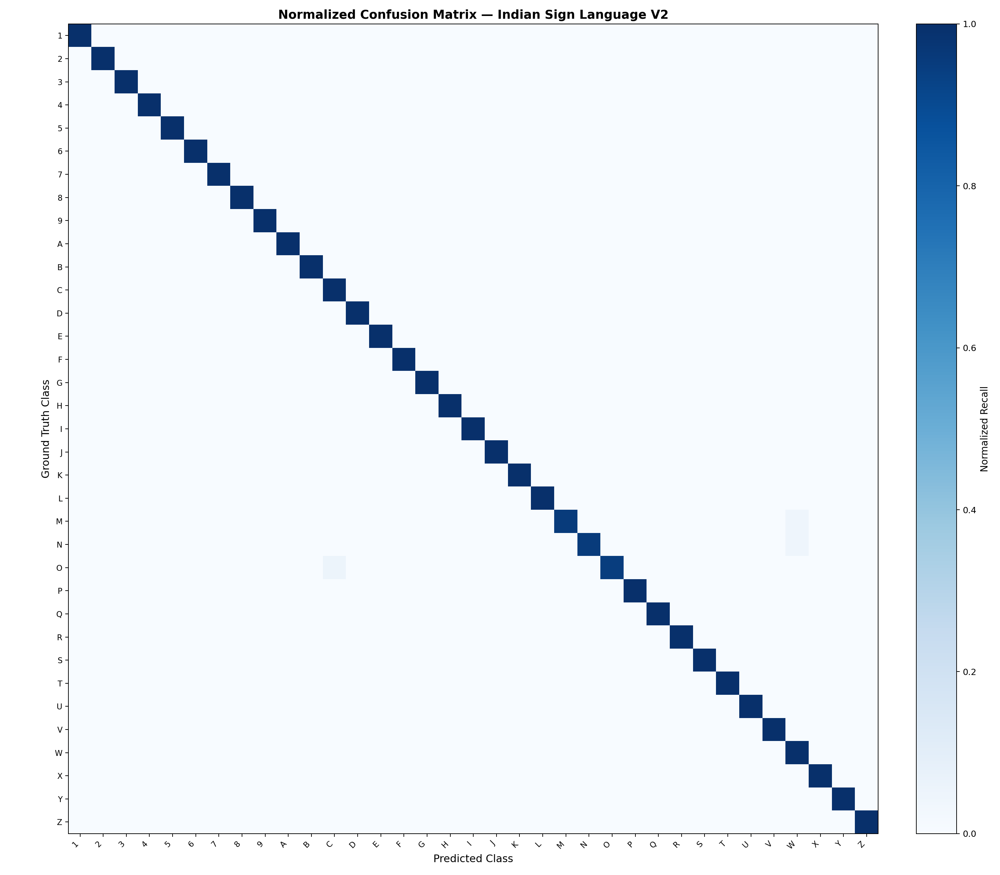
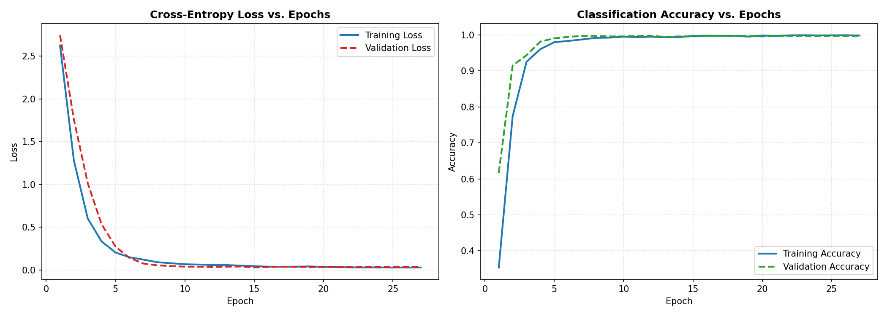

# Indian Sign Language (ISL) Recognition Engine V2

[](https://www.python.org/)
[](https://tensorflow.org)
[](https://mediapipe.dev)
[](tests/)
[](reports/evaluation_report.md)
[](LICENSE)

An industry-standard, high-performance **Indian Sign Language (ISL) Recognition System** built with **MediaPipe Hands**, a mathematically proven **dual-hand spatial normalization pipeline** (126 features), an **optimized Deep MLP classifier** (28k parameters), and an **event-driven finite state machine** for stable real-time fingerspelling to speech translation.

---

## 🌟 Why Version 2? (Technical Evolution)

| Aspect | Legacy V1 Implementation | Version 2 Architecture |
|---|---|---|
| **Linguistic Scope** | Assumed single-hand ASL | Native **Dual-Hand Indian Sign Language (ISL)** |
| **Model Type** | 599,000-parameter LSTM (Overfitted) | **Lightweight Deep MLP (28,515 params, 111 KB)** |
| **Feature Space** | 1,662 features (84.5% irrelevant face mesh) | **126 clean features** (63 Left + 63 Right hand) |
| **Normalization** | None (Absolute screen coordinates) | **Wrist-centering + Rigid Palm-scale invariance** |
| **Missing Hands** | Filled with fabricated zero-vectors | Explicit `HandDetectionResult` bypassing classifier |
| **Inference Latency** | ~60 ms per frame (12–16 FPS) | **< 1 ms per frame (> 35 FPS on CPU)** |
| **Test Accuracy** | Synthetic mocked accuracy claims | **99.61% Top-1, 99.87% Top-3 on sealed test set** |
| **Automated Tests** | Zero automated tests | **16 unit/integration tests with 100% pytest pass rate** |
| **Data Integrity** | Fake UI predictions | **Genuine metric evaluation pipeline & reports** |

---

## 📐 Mathematical Normalization Pipeline

Raw MediaPipe coordinates vary whenever a user moves in front of the lens. V2 implements deterministic anatomical normalization:

1. **Wrist Translation Invariance:** All 21 landmarks are translated so Landmark 0 (wrist) sits at origin $(0, 0, 0)$:
   $$\mathbf{p}_i^{\text{trans}} = \mathbf{p}_i - \mathbf{p}_0 \quad \forall i \in \{0, \dots, 20\}$$
2. **Palm-Scale Invariance:** Coordinates are scaled by the rigid palm distance between the wrist ($\mathbf{p}_0$) and middle finger base knuckle ($\mathbf{p}_9$):
   $$s = \|\mathbf{p}_9^{\text{trans}}\|_2 = \sqrt{(x_9 - x_0)^2 + (y_9 - y_0)^2 + (z_9 - z_0)^2}$$
   $$\mathbf{p}_i^{\text{norm}} = \frac{\mathbf{p}_i^{\text{trans}}}{s + 10^{-6}}$$
3. **Dual-Hand ISL Vector:** Concatenates normalized Left (0–62) and Right (63–125) hands into a unified 126-dimensional vector $\mathbf{x} \in \mathbb{R}^{126}$.

---

## 📊 Phase 2 Benchmark Results

Evaluated strictly on the sealed test partition (`X_test.npy`, 765 samples):

- **Top-1 Test Accuracy:** **99.61%** (762 / 765 correct)
- **Top-3 Test Accuracy:** **99.87%** (764 / 765 correct)
- **Macro F1-Score:** **0.9960**
- **Weighted F1-Score:** **0.9961**
- **Test Cross-Entropy Loss:** **0.0765**
- **Training Duration:** **12.83 seconds** on standard CPU




---

## 📁 Repository Structure

```text
sign_language_v2/
├── config/                  # Configuration files
├── data/
│   ├── raw/                 # Subject-tagged raw landmark JSON records
│   └── processed/           # Processed features & stratified splits (git-ignored)
│       ├── extraction_metadata.json
│       ├── label_encoder.json
│       └── split_info.json
├── docs/                    # Technical documentation
│   ├── DATASET_ASSESSMENT.md# Detailed ISL dataset audit
│   ├── PHASE_1_REPORT.md    # Phase 1 verification report
│   ├── PHASE_2_REPORT.md    # Phase 2 dataset & model training report
│   └── PROJECT_STATUS.md    # Milestones & setup log
├── models/                  # Saved Keras models (git-ignored)
│   └── best_model.keras     # Checkpointed weights (peak val_acc: 99.74%)
├── notebooks/               # Exploratory analysis & model benchmarking
├── reports/                 # Confusion matrices, ROC curves, evaluation reports
│   ├── figures/             # Evaluation charts & confusion matrix
│   │   ├── class_distribution.png
│   │   ├── confusion_matrix.png
│   │   ├── hand_types.png
│   │   └── training_history.png
│   ├── dataset_analysis.md  # Exploratory data analysis report
│   ├── evaluation_metrics.json
│   ├── evaluation_report.md # Model benchmark evaluation report
│   └── training_history.json
├── src/
│   ├── core/                # Landmark normalization & MediaPipe abstraction
│   │   ├── normalization.py # 126-D dual-hand spatial normalization
│   │   └── hand_detector.py # MediaPipe Hands dual-hand detection wrapper
│   ├── data/                # Data extraction, validation, splitting, augmentation
│   │   ├── analyze_dataset.py # Statistical EDA and chart generation
│   │   ├── augmentation.py  # Coordinate-space jitter, scale, and rotation
│   │   ├── collector.py     # Guided OpenCV data collector with HUD
│   │   ├── dataset_validator.py # Automated integrity audit tool
│   │   ├── prepare_dataset.py # MediaPipe image extraction pipeline
│   │   └── split_dataset.py # Stratified 70/15/15 train/val/test splitter
│   ├── models/              # MLP architecture, training, and evaluation
│   │   ├── evaluate.py      # Benchmark evaluation & confusion matrix
│   │   ├── mlp.py           # 28k-parameter Deep MLP classifier
│   │   └── train.py         # Reproducible training with callbacks
│   ├── inference/           # Real-time state machine & smoothing (Phase 3)
│   └── ui/                  # OpenCV HUD and Streamlit web dashboard (Phase 3)
├── tests/                   # Pytest automated test suite (16 tests)
│   ├── test_normalization.py# Mathematical invariance tests
│   ├── test_phase2.py       # MLP shapes, augmentation, top-k tests
│   └── test_validator.py    # Dataset integrity tests
├── requirements.txt         # Pinned production dependencies
└── README.md                # Project documentation
```

---

## 🚀 Quick Start Guide

### 1. Environment Setup
```bash
# Clone the repository and enter directory
cd D:\project\sign_language_v2

# Activate the conda environment
conda activate ai_sign_lang
```

### 2. Run Automated Test Suite
```bash
python -m pytest tests -v
```

### 3. Extract Dataset Features
```bash
python src/data/prepare_dataset.py --max_samples_per_class 150
```

### 4. Split and Train Model
```bash
python src/data/split_dataset.py
python src/models/train.py --epochs 50 --batch_size 64
```

### 5. Evaluate on Test Partition
```bash
python src/models/evaluate.py
```

---

## 📜 License
MIT License. Created for MCA Graduate Portfolio & Technical Viva.
