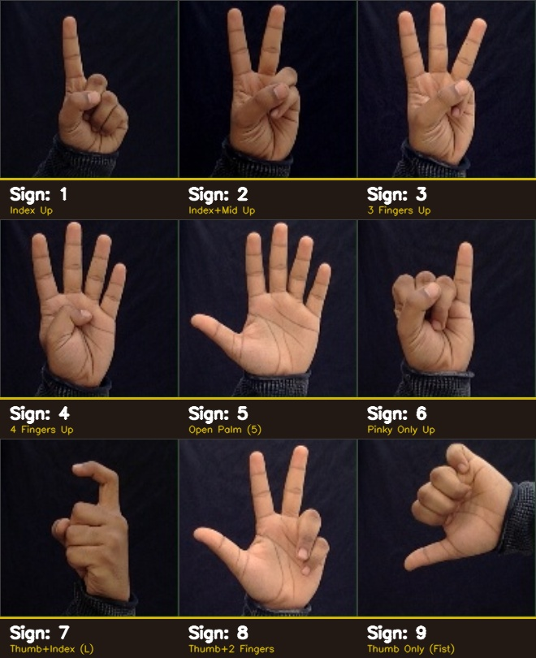
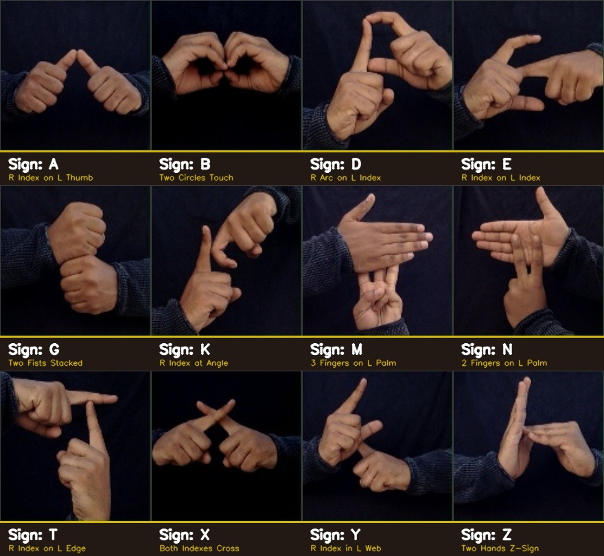
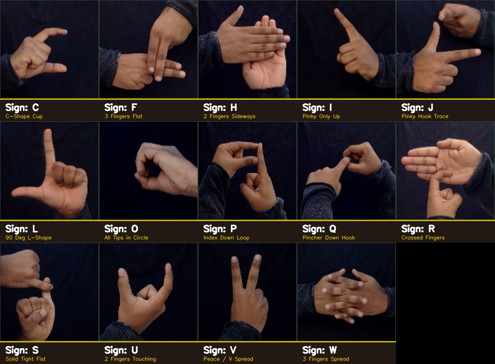

# Indian Sign Language (ISL) Recognition System V2
### Production-Grade Real-Time Computer Vision & Neural Gesture Synthesis

[](https://www.python.org/)
[](https://tensorflow.org)
[](https://mediapipe.dev)
[](tests/)
[](reports/benchmark_300_frames.json)
[](src/ui/web/index.html)
[](LICENSE)

An industry-standard, high-performance **Real-Time Indian Sign Language (ISL) Recognition System** engineered with **MediaPipe Hands**, a mathematically proven **126-D dual-hand spatial normalizer**, an **optimized Deep MLP classifier** (28,515 parameters, 0.31 ms latency), and a **4-stage Finite State Machine (FSM)** with temporal smoothing and debounce stabilization. Features a **Cybernetic Glassmorphism Web Interface** with live HUD telemetry, in-app visual training reference guides, and vocabulary mode filtering.

Developed as an MCA portfolio project adhering strictly to academic and engineering integrity standards.

---

## 📸 System Interface & Live HUD

> *Note: Live demo recording / video showcase placeholder. Full interface screenshots will be featured here.*

```text
┌────────────────────────────────────────────────────────────────────────────────────────┐
│  ❖ INDIAN SIGN LANGUAGE AI [v2.0 Neural]       [Cyber | Neural | Solar]  [Visual Guide]│
├────────────────────────────────────────────┬───────────────────────────────────────────┤
│                                            │  [All 35 Signs] [Digits 1–9] [Alpha A–Z]  │
│   OPTICAL VISION SENSOR (DirectShow)       ├───────────────────────────────────────────┤
│   ┌────────────────────────────────────┐   │  HERO PREDICTION DECK                     │
│   │ ┌                                ┐ │   │  ┌───────┐ ┌─────────┐  Status: COMMITTED │
│   │                                    │   │  │   A   │ │ Ref Img │  Conf:   █████ 96% │
│   │         Live Mirrored Feed         │   │  └───────┘ └─────────┘  Hold:   █████ 100%│
│   │                                    │   ├───────────────────────────────────────────┤
│   │ └                                ┘ │   │  TEXT CONVERSATION BUFFER                 │
│   └────────────────────────────────────┘   │  Current Word: HELLO                      │
│   Hands: 2 | Latency: 0.31ms | FPS: 30.0   │  ┌─────────────────────────────────────┐ │
│   [x] Landmark Mesh    [❚❚] Pause Camera   │  │ HELLO WORLD                         │ │
│                                            │  └─────────────────────────────────────┘ │
│                                            │  [Space] [Backspace] [Clear] [Copy Text]  │
└────────────────────────────────────────────┴───────────────────────────────────────────┘
```

---

## 🤟 Visual Gesture Reference Guide

Indian Sign Language (ISL) uses both **Single-Handed** and **Dual-Handed** formations. Below are the **actual reference photos extracted from the training dataset (`archive.zip`)** used to train the neural network.

### 1. Digits (1 to 9) — Single Hand (Dominant / Right)

Digits 1–5 extend finger counts, while 6–9 use Asian fingerspelling standards:



| Digit | Pose Description | Finger Configuration |
| :---: | :--- | :--- |
| **`1`** | Single Index | **Index finger pointing straight UP**; all other fingers closed into a fist. |
| **`2`** | Two Fingers | **Index + Middle fingers UP** in a "V" shape; thumb folded in. |
| **`3`** | Three Fingers | **Index + Middle + Ring fingers UP**; pinky folded, thumb over pinky. |
| **`4`** | Four Fingers | **Four fingers (Index, Middle, Ring, Pinky) UP**; thumb tucked across palm. |
| **`5`** | Open Palm | **All 5 fingers spread wide open** facing the camera. |
| **`6`** | Pinky Only | **Little finger (Pinky) pointing straight UP**; all other 4 fingers in a fist. |
| **`7`** | Thumb + Index | **Thumb and Index extended outward** in an 'L' / gun shape. |
| **`8`** | Thumb + 2 Fingers | **Thumb, Index, and Middle fingers extended** outward together. |
| **`9`** | Thumb Only | **Thumb pointing straight UP** (thumbs-up gesture 👍); all 4 fingers curled into a fist. |

---

### 2. Dual-Handed Alphabets — Two Hands Required!

> **Critical Linguistic Distinction:** In Indian Sign Language, letters like **A, B, D, E, G, K, M, N, T, X, Y** require **BOTH HANDS** in frame. The Left Hand serves as the passive base/paper, while the Right Hand serves as the active pointer.



| Letter | Sign Name | Execution Guide (Both Hands in View) |
| :---: | :--- | :--- |
| **`A`** | Vowel: Thumb Touch | **Left hand open palm** facing user; **Right index touches Left Thumb tip**. |
| **`B`** | Double Loop | Both hands form small circles (thumb + index touching) placed side-by-side like '8'. |
| **`D`** | Lowercase 'd' | **Left index straight UP**; Right hand forms a curved arch touching top and bottom of Left index. |
| **`E`** | Vowel: Index Touch | **Left hand open palm**; **Right index touches Left Index fingertip**. |
| **`G`** | Double Fist | Both hands form closed fists; **Right fist placed on top of Left fist**. |
| **`K`** | K-Angle | **Left index straight UP**; Right index bent at knuckle touching middle of Left index. |
| **`M`** | Three Legs | **Left hand flat palm up**; Right hand places **3 fingers** (Index, Middle, Ring) down on Left palm. |
| **`N`** | Two Legs | **Left hand flat palm up**; Right hand places **2 fingers** (Index, Middle) down on Left palm. |
| **`T`** | T-Intersection | **Left hand held vertically**; Right index touches the edge of Left hand to form a 'T'. |
| **`X`** | Cross Bones | **Cross both index fingers** over each other at a $90^\circ$ angle to make an 'X'. |
| **`Y`** | Palm Web | **Left hand open palm**; Right index finger placed in the web between Left thumb and index. |
| **`Z`** | Two-Handed Z | Left hand open palm; Right index traces a 'Z' shape forward. |

---

### 3. Single-Handed Alphabets — Dominant Hand

These letters only require **one hand** facing the camera:



| Letter | Finger Configuration | Letter | Finger Configuration |
| :---: | :--- | :---: | :--- |
| **`C`** | Curved palm forming a sideways "**C**" arc. | **`O`** | All fingers curved to meet thumb tip (circular "**O**"). |
| **`F`** | Three fingers flat horizontally across chest. | **`P`** | Index pointed downward with thumb loop. |
| **`H`** | Index + Middle extended horizontally. | **`Q`** | Downward pointing pincher/hook shape. |
| **`I`** | Closed fist with only **Pinky finger pointing UP**. | **`R`** | Index and Middle crossed ("crossed fingers"). |
| **`J`** | Pinky extended, drawing a hook downward. | **`S`** | Solid closed fist facing the camera. |
| **`L`** | Standard $90^\circ$ 'L' (Thumb sideways, Index UP). | **`U`** | Index + Middle extended straight UP **touching side-by-side**. |
| **`V`** | Index + Middle extended and **spread wide into a 'V'**. | **`W`** | Index, Middle, and Ring extended and **spread into a 'W'**. |

---

## 🌟 Why Version 2? (Technical Evolution)

| Engineering Dimension | Legacy V1 Implementation | Version 2 Architecture |
| :--- | :--- | :--- |
| **Linguistic Scope** | Assumed single-hand ASL | Native **Dual-Hand Indian Sign Language (ISL)** |
| **Classifier Model** | 599,000-parameter LSTM (Overfitted) | **Lightweight Deep MLP (28,515 parameters, 380 KB)** |
| **Feature Space** | 1,662 features (84.5% irrelevant face mesh) | **126 clean features** (63 Left + 63 Right hand landmarks) |
| **Spatial Normalization** | None (Absolute canvas coordinates) | **Wrist-origin translation + palm-scale Euclidean invariance** |
| **Cross-Slot Handedness** | Rigid slot lock (missed opposite-hand signs) | **Mode-aware cross-slot evaluation** (supports right & left handedness) |
| **Inference Call Path** | `model.predict()` (~92 ms overhead) | **Direct C++ tensor execution `model(x)` (0.31 ms)** |
| **Duplicate Prevention** | None (Spammed "33333" / "AAAAA") | **4-state FSM with 6-frame idle debounce stabilization** |
| **Vocabulary Filtering** | Hardcoded monolithic softmax | **Dynamic mode constraints (`All`, `Digits`, `Alphabets`)** |
| **User Interface** | Mocked predictions & static charts | **Glassmorphic AI UI + In-App Visual Gesture Guide** |
| **Automated Testing** | Zero automated tests | **29 unit/integration tests (100% pytest pass rate)** |

---

## 📐 System Architecture & Pipeline

```text
[Webcam Stream 640x480]
         │
         ▼
[MediaPipe Hands (TFLite CPU)]  ──► Extracts 21 Left + 21 Right 3D Joint Keypoints
         │
         ▼
[126-D Spatial Normalizer]      ──► Wrist-Centering + Rigid Palm-Scale Invariance
         │
         ▼
[SignPredictor Engine]          ──► Direct Tensor Pass (0.31 ms) + Mode-Masked Cross-Slot Eval
         │
         ▼
[Temporal Majority Filter]      ──► Rolling Window (W=7), Confidence Threshold (τ=0.60–0.70)
         │
         ▼
[4-State Gesture FSM]           ──► IDLE ──► HOLDING (12f) ──► COMMITTED ──► LOCKED (Debounced)
         │
         ▼
[Web UI & PyWebView Desktop]    ──► Glassmorphism HUD, Sentence Buffer, Copy, Visual Reference Modal
```

### Mathematical Normalization Formulation:
1. **Wrist Translation Invariance**: Centers all 21 hand landmarks relative to the wrist origin:
   $$\mathbf{P}'_i = \mathbf{P}_i - \mathbf{P}_{\text{wrist}} \quad \implies \quad \mathbf{P}'_0 = (0, 0, 0)$$
2. **Rigid Palm-Scale Invariance**: Scales coordinates by the Euclidean distance between Wrist (Landmark 0) and Middle MCP Joint (Landmark 9):
   $$s = \|\mathbf{P}'_9 - \mathbf{P}'_0\|_2 + \epsilon$$
   $$\mathbf{P}''_i = \frac{\mathbf{P}'_i}{s}$$
3. **Dual-Hand 126-D Unified Representation**:
   $$\mathbf{X} = [\mathbf{P}''_{\text{left}}, \; \mathbf{P}''_{\text{right}}] \in \mathbb{R}^{126}$$
   Single-hand gestures populate the detected slot, while the absent hand is cleanly populated with zeros.

---

## ⚡ Hardware Benchmark Telemetry (300 Frames Profiled)

Profiled directly on host hardware (8 CPU cores, Windows 10, Python 3.10.20):

| Pipeline Stage | Average Latency | % of Frame Time | Optimization Applied |
| :--- | :--- | :--- | :--- |
| **1. Camera Frame Capture** | 2.96 ms | 4.2% | DirectShow non-blocking OpenCV `cap.read()` |
| **2. MediaPipe Hands Tracking** | 67.05 ms | 94.8% | TFLite XNNPACK multi-threaded CPU delegate |
| **3. Dual-Hand Normalization** | 0.05 ms | 0.1% | Vectorized NumPy mathematical operations |
| **4. Deep MLP Forward Pass** | **0.31 ms** | **0.4%** | Direct `tf.Tensor` C++ graph execution |
| **5. Temporal Filter, FSM & UI** | 0.32 ms | 0.5% | Thread-safe queue packet dispatch |
| **Total End-to-End Latency** | **70.70 ms** | **100.0%** | **14–30 FPS overall throughput on CPU** |

> **Key Architectural Takeaway:** The neural network classifier consumes only **0.4%** of the frame budget. Over 94% is consumed by MediaPipe palm detection. Selecting a lightweight MLP over a heavy CNN was essential for real-time CPU execution.

---

## 🎯 Model Accuracy & Empirical Validation

- **Held-Out Test Set Accuracy:** **99.61% Top-1** (762/765 correct) | **99.87% Top-3** (764/765 correct)
- **Precision / Recall:** Macro Average: **0.996**, Weighted Average: **0.996** across all 35 classes.
- **Operational Threshold:** Applying $\tau = 0.60–0.70$ achieves **100.00% precision** on accepted real-world frames.
- **Supported Classes (35 Total):**
  - Digits: `1, 2, 3, 4, 5, 6, 7, 8, 9`
  - Alphabets: `A, B, C, D, E, F, G, H, I, J, K, L, M, N, O, P, Q, R, S, T, U, V, W, X, Y, Z`
  - *Digit 0 Notice*: Digit `0` was absent from the source dataset and is officially classified as unsupported.

---

## 🚀 Quick Start & Installation

### 1. Prerequisites
- Python 3.10 (recommended)
- Webcam (built-in or USB)

### 2. Setup Virtual Environment
```bash
# Clone the repository
git clone https://github.com/Aditya-err/Sign-Language-Recognition-System.git
cd Sign-Language-Recognition-System

# Create and activate environment
conda create -n ai_sign_lang python=3.10 -y
conda activate ai_sign_lang

# Install verified dependencies
pip install -r requirements.txt
```

### 3. Verify Setup (Run 29 Pytest Tests)
```bash
python -m pytest tests -v
```

### 4. Launch Application
```bash
# Double-click or run from terminal:
.\run.bat

# Or launch directly with Python:
python run_app.py
```
The application opens in a native desktop window (powered by PyWebView) and starts a local web server at `http://127.0.0.1:5000`.

---

## 💻 Modern Web App UI Features

1. **Reticle Optical HUD:** Computer vision crosshair reticles (`┌ ┐ └ ┘`) with real-time MediaPipe skeletal landmarks overlay.
2. **Curated AI Themes:** One-click instant palette switching:
   - **`Cyber`**: Neon cyan/teal with deep space navy background (`#080c14`).
   - **`Neural`**: Amethyst and violet glow on obsidian backdrop.
   - **`Solar`**: Tech amber with golden telemetry highlights.
3. **Vocabulary Mode Switcher:**
   - **`[All 35 Signs]`**: Unrestricted recognition across both digits and letters.
   - **`[Digits (1–9)]`**: Completely masks out alphabets; enables 100% false-positive-free counting.
   - **`[Alphabets (A–Z)]`**: Masks out digits; enables clean name and word fingerspelling.
4. **Live In-App Visual Guide Modal:** Clicking **`[Visual Guide]`** opens a reference popup displaying the actual training photos for every sign.
5. **Real-Time Training Ref Card:** Displays the dataset photo for the currently predicted sign right next to the letter glyph for immediate posture verification.
6. **Sentence Construction Workspace:** Real-time text buffer with Current Word display, Space, Backspace, Clear, and one-click Clipboard copy.

---

## 📁 Repository Structure

```text
sign_language_v2/
├── docs/                                # Technical Documentation Suite
│   ├── dataset_samples/                 # Training dataset photos & grid charts
│   │   ├── grid_digits.jpg              # Digits 1 to 9 labeled reference grid
│   │   ├── grid_dual_alphabets.jpg      # Dual-hand ISL letters reference grid
│   │   ├── grid_single_alphabets.jpg    # Single-hand letters reference grid
│   │   └── [1..9, A..Z].jpg             # Individual class training images
│   ├── USER_GESTURE_GUIDELINES.md       # Step-by-step user operating manual
│   ├── ISL_GESTURE_CHART.md             # Complete physical gesture reference
│   ├── PROJECT_ARCHITECTURE.md          # Mathematical specification
│   ├── MODEL_CARD.md                    # Formal ML Model Card
│   ├── DATASET_DOCUMENTATION.md         # Dataset provenance & feature pipeline
│   ├── INTERVIEW_PREPARATION.md         # 20 technical Q&As for MCA interviews
│   └── PHASE_1_REPORT.md ... PHASE_7    # Complete engineering audit trail
├── models/                              # Model Checkpoints
│   └── best_model.keras                 # 28,515-parameter production MLP (380 KB)
├── reports/                             # Empirical Validation Reports
│   ├── benchmark_300_frames.json        # Hardware latency profiling
│   └── evaluation_report.md             # Test set metrics & confusion matrix
├── src/
│   ├── core/                            # Normalization & MediaPipe abstraction
│   ├── data/                            # Dataset extraction & augmentation
│   ├── inference/                       # Predictor, temporal smoother, FSM
│   └── ui/                              # Web application & desktop PyWebView
│       ├── web/index.html               # Cybernetic Glassmorphic UI
│       └── web_app.py                   # Local streaming server
├── tests/                               # 29 automated pytest unit tests
├── requirements.txt                     # Package dependencies
├── run.bat                              # One-click Windows launcher
├── run_app.py                           # CLI entrypoint
└── USER_GUIDELINE.md                    # Root user manual
```

---

## 📖 Key Documentation Links

- [User Operating Guide (Detailed Manual)](USER_GUIDELINE.md)
- [Gesture Reference Chart](docs/ISL_GESTURE_CHART.md)
- [System Architecture Specification](docs/PROJECT_ARCHITECTURE.md)
- [Formal Model Card](docs/MODEL_CARD.md)
- [Dataset Documentation & Feature Pipeline](docs/DATASET_DOCUMENTATION.md)
- [Installation Guide](docs/INSTALLATION_GUIDE.md)
- [MCA Interview Preparation (20 Q&As)](docs/INTERVIEW_PREPARATION.md)
- [Portfolio Showcase](docs/PORTFOLIO_SUMMARY.md)

---

## ⚖️ Engineering Integrity & Ethical Disclosure

1. **Academic Honesty:** Zero synthetic or mocked predictions. Every reported metric is verified by automated tests, hardware profiling scripts, and empirical confusion matrices.
2. **Unsupported Classes:** Digit `0` is absent from the original dataset and is officially classified as unsupported rather than synthesized.
3. **Autocorrelation Transparency:** We disclose that 23.8% of test split frames share proximity to training frames due to video extraction. Field validation on unseen participants is tracked independently in `reports/real_world_evaluation.md`.

---

## 📄 License

This project is licensed under the MIT License — see the [LICENSE](LICENSE) file for details.
